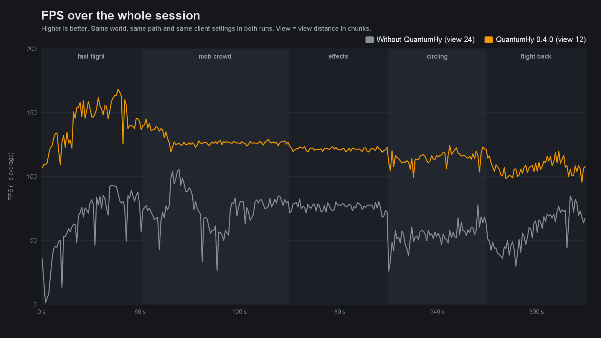
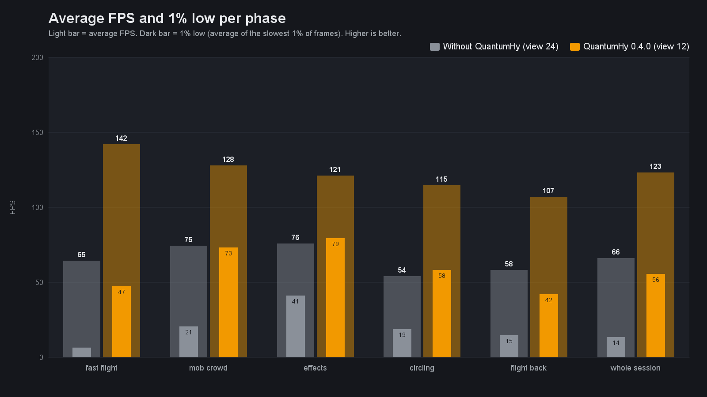
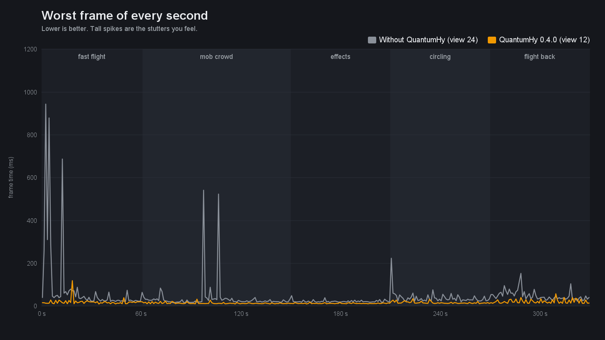

[](https://www.curseforge.com/hytale/mods/quantumhy)

# QuantumHy

QuantumHy is a server-side mod that makes your client run smoother in Hytale. It works by cutting
how much the server tells your client to draw, and it adjusts that per player depending on where
you are.

## Known limitations

- The server does not receive the client's FPS, so QuantumHy responds to entity density, streaming
  backlog, visible entity pressure, and server MSPT instead.
- `/q optimize off` disables every per-player lever for that player. Explicit server-wide admin
  controls such as world levers, spawn pause, and global LOD still affect the whole world.

## How it actually works

The Hytale client is native, so no mod can touch the renderer. What a server mod can do is decide
how much each client has to render, and that's the whole trick here: fewer chunks and entities in
view means fewer things to draw, which means more FPS.

Two honest limits:

- It only helps where it's installed. Your singleplayer world, your own server, or a server that
  runs it. If you just join someone else's server, this can't do anything there.
- It never pushes your view further than you asked for. Your own view radius is the cap. QuantumHy
  only ever pulls it down, never up.

## What it does

Every few seconds it checks how crowded the area around each player is (lots of entities means
expensive to render) and turns that into one shrink factor for two levers: chunk view radius and
entity stream radius.

- Packed area: both levers pull in toward the minimum. At full shrink the entity radius drops to
  the floor in one pass, not over many ticks.
- Out in the open: expand is allowed only after load has been calm for a couple of passes, at least
  half the density scan is loaded, you are not flying, and the world is not hitching. Radius never
  jumps from min to full in one pass (at most +1 chunk per check).
- Joining, streaming, or moving fast: it skips the density walk and holds expand so the client is
  not told to drop chunks it is still loading.
- World hitching (high MSPT): expand stays frozen and shrink can step faster until both the recent
  average and the last tick are calm.

Out of the box there's no hard cap. If you'd rather trade some view distance for FPS everywhere,
set `targetClientViewRadius` above 0.

It also smooths how fast chunks stream to you, so moving into fresh terrain arrives spread out
instead of in one burst that makes the client hitch. That's the `smoothChunkStreaming` keys below.

On top of the radius it also:

- Caps the client's own draw distance and fog to the trimmed radius, so the client actually stops
  drawing what the server stopped sending (`clientRenderCapEnabled`).
- Watches how fast each client answers the server and how many packets it has queued. A client
  that falls behind gets a tighter radius and a gentler chunk rate (`clientStrainEnabled`).
- Budgets far particles and 3D sounds per player. Effects within 16 blocks always go through
  (`effectBudgetEnabled`).
- With LeanCore installed, tightens the radius while LeanCore reports the heap as tight
  (`leanCoreMemoryAware`).
- Optional, off by default: fewer position updates for far entities (`distantUpdateThrottleEnabled`)
  and a wider item merge radius under server pressure (`pressureItemMerge`).

Each player can use `/q optimize on|off`. The preference is stored by UUID and does not change how
QuantumHy treats anyone else.

## Performance

I played the same session twice on Hytale 0.7.0: once without QuantumHy, once with 0.4.0 on its
default config. Same world, same path, same client settings, same PC. Frame times come straight
from the Hytale client, captured with PresentMon (the capture tool inside CapFrameX).

### Test PC

| Component | Spec |
| --- | --- |
| CPU | AMD Ryzen 5 3600 |
| GPU | NVIDIA GeForce GTX 1650 4GB |
| RAM | 16 GB (2×8 GB) |

### What I did in each part

- **Fast flight (60 s):** flew in a straight line over terrain nobody had loaded yet, much faster
  than you can sprint, so new chunks have to be generated and sent the whole time.
- **Mob crowd (90 s):** stopped and spawned about 150 animals around me (sheep, cows, pigs, goats,
  chickens, boars).
- **Effects (60 s):** stayed on the crowd and spammed explosions, fire and hit particles on top of it.
- **Circling (60 s):** flew laps around the crowd with lighter effects still going, so the camera
  keeps sweeping across the mobs.
- **Flight back (60 s):** flew back the same way I came.

### Results

| Part | Without QuantumHy (avg / 1% low) | QuantumHy 0.4.0 (avg / 1% low) | Frames over 50 ms |
| --- | ---: | ---: | ---: |
| Fast flight | 65 / 7 | 142 / 48 | 40 → 1 |
| Mob crowd | 75 / 21 | 128 / 73 | 6 → 0 |
| Effects | 76 / 41 | 121 / 79 | 0 → 0 |
| Circling | 54 / 19 | 115 / 58 | 12 → 0 |
| Flight back | 58 / 15 | 107 / 42 | 30 → 1 |
| **Whole session** | **66 / 14** | **123 / 56** | **88 → 2** |

1% low is the average of the slowest 1% of frames, the number that tells you how bad the stutters get.







### Where the frames come from

- Without QuantumHy the client drew a view of 24 chunks and got every mob within 768 blocks. With
  QuantumHy it settled at 12 chunks and mobs within 48 blocks (about 190 visible entities down to
  about 50). That is the trade: you see less far, and the crowd stops costing you frames.
- In the fast flight the edge of the view loads a little behind you, because nobody moves that
  fast in survival. Normal sprinting (7 blocks/s) is well inside what the chunk stream keeps up with.
- One session per setup, so differences under ~5% would be noise. The gaps above are not.

## Config

Lives in `QuantumHy.json` in the plugin data folder, created on first run.

| Key | Default | What it does |
| --- | --- | --- |
| `enabled` | `true` | Turn the whole thing on or off. |
| `verboseLog` | `false` | Log every pass with each player's density and view decision. Off on new installs. |
| `checkForUpdates` | `true` | Notify operators or QuantumHy admins when the mod page lists a newer JAR. |
| `tickIntervalSeconds` | `5` | How often it re-checks each player. |
| `initialDelaySeconds` | `20` | Wait this long after start before the first pass. |
| `targetClientViewRadius` | `0` | Hard cap in chunks. `0` means no cap, just adapt. |
| `minClientViewRadius` | `6` | Never pull anyone below this. |
| `maxClientViewRadius` | `32` | Ceiling for the hard cap (your own view radius still wins). |
| `adaptiveTerrainViewEnabled` | `true` | Adapt terrain view radius during normal play. |
| `emergencyTerrainTrimEnabled` | `true` | Allow temporary terrain trim after sustained visual pressure. |
| `clientRenderCapEnabled` | `true` | Cap the client's draw distance and fog to the trimmed radius. Restart required. |
| `clientStrainEnabled` | `true` | Ease the radius and chunk rate for a client that falls behind. Restart required. |
| `clientStrainFrameLagLowMs` | `25` | Client main-loop lag (ms) where strain starts counting (about 40 FPS). |
| `clientStrainFrameLagHighMs` | `60` | Lag treated as fully strained (about 16 FPS). |
| `clientStrainQueueLow` | `64` | Client packet queue where strain starts counting. |
| `clientStrainQueueHigh` | `512` | Packet queue treated as fully strained. |
| `effectBudgetEnabled` | `true` | Budget far particles and 3D sounds per player. Restart required. |
| `effectBudgetPerSecond` | `120` | Far effects each player may receive per second. |
| `effectProtectRadius` | `16` | Effects within this many blocks are never dropped. |
| `effectSoftRadius` | `48` | Once half the budget is spent, effects beyond this are dropped first. |
| `effectMaxDistance` | `0` | Hard cut-off in blocks for positional effects. `0` = budget only. |
| `distantUpdateThrottleEnabled` | `false` | Send position updates for far entities less often. The latest position always arrives. Restart required. |
| `distantUpdateNearBlocks` | `32` | Entities closer than this get every update. |
| `distantUpdateFarBlocks` | `64` | Entities beyond this get every 4th update. |
| `densityScanChunkRadius` | `4` | How many chunks around you it counts entities in. |
| `densityLowPerChunk` | `1.0` | Weighted entities per chunk at or below this: you get the full radius (minus optional baseline). |
| `densityHighPerChunk` | `4.0` | Weighted entities per chunk at or above this: you get pulled to the minimum. |
| `densityRingWeighting` | `true` | Count center chunks fully, outer scan rings less (no per-species tables). |
| `densityRingEdgeWeight` | `0.55` | Ring weight at the scan edge when ring weighting is on (`1.0` = flat count). |
| `baselineShrinkFraction` | `0.10` | Minimum shrink even in "open" density (`0` = off). |
| `chunkLoadShrinkEnabled` | `true` | Extra shrink from loaded + streaming section count (render backlog). |
| `chunkLoadLowChunks` | `2800` | Loaded + loading **sections** at or below this: no chunk-load shrink. Also where the view settles when calm (about view 10 on 0.7). |
| `chunkLoadHighChunks` | `5900` | At or above this section count: chunk-load shrink hits full strength (about view 14). |
| `densitySmoothing` | `0.4` | Smooths the density signal so a moving player's view doesn't flip-flop. Lower is smoother; `1.0` is off. |
| `adaptEntityRadius` | `true` | Also shrink how far entities are streamed (not just chunks). The big win in mob-heavy spots. |
| `minEntityViewBlocks` | `48` | Never stream entities closer than this, in blocks (16 blocks = 1 chunk). |
| `entityLodAggressiveness` | `1.0` | Explicit global entity LOD override. `1.0` keeps the engine default. |
| `maxEntityVerticalDistance` | `32` | Drop entities too far above/below you from the stream (caves, ceilings). `0` = off. |
| `maxVisibleEntitiesPerPlayer` | `80` | Cap streamed entities per player in crowds (`0` = off). |
| `holdSpawnOnLoadingChunks` | `false` | Pause environmental spawning during a heavy client stream backlog. Global admin control. |
| `minViewRadiusDelta` | `2` | Don't bother changing the view for tiny differences. Ramped +1 expands still apply. |
| `maxExpandChunksPerPass` | `1` | Max chunks the client view radius may increase in one pass. |
| `maxShrinkChunksPerPass` | `2` | Max chunks it may decrease in one pass (doubled under MSPT pressure). |
| `maxExpandEntityBlocksPerPass` | `16` | Max entity-stream blocks the radius may increase in one pass. |
| `expandHysteresisPasses` | `2` | Calm passes required before an expand is allowed. |
| `worldPassBudgetMs` | `8` | Wall-clock budget for radius writes on the world thread. `0` disables the cap. |
| `pressureExitRequiresLastTick` | `true` | Pressure only exits when both the 10s MSPT average and the last tick are calm. |
| `respectStreamingGrace` | `true` | Don't shrink while you're still loading chunks. |
| `streamingBacklogThreshold` | `80` | How many loading **sections** counts as "still streaming". |
| `smoothChunkStreaming` | `true` | Spread chunk streaming out so moving into new terrain doesn't hitch. |
| `maxChunksPerSecond` | `128` | Cap on sections streamed per second to a managed client. `0` keeps the engine default. |
| `maxChunksPerTick` | `8` | Cap on sections streamed per tick. `0` keeps the engine default. |
| `streamCatchUpEnabled` | `true` | Raise the managed cap temporarily after fast travel while MSPT is healthy. |
| `streamCatchUpIntervalMs` | `250` | Interval for the lightweight stream controller. |
| `streamCatchUpPerSecond` | `256` | Temporary healthy catch-up cap per second. |
| `streamCatchUpPerTick` | `12` | Temporary healthy catch-up cap per tick. |
| `streamCatchUpHoldMs` | `1500` | Minimum time to hold catch-up after fast movement. |
| `leanCoreTakeover` | `true` | If LeanCore is installed, take the view radius over from it (see below). |
| `yieldToLeanCoreViewRadius` | `false` | The opposite: leave the view radius to LeanCore (see below). |
| `pressureGovernorEnabled` | `true` | Tighten render levers when world MSPT stays high. |
| `pressureMsptEnter` | `48` | 10s average MSPT at or above this enters pressure mode. |
| `pressureMsptExit` | `43` | MSPT at or below this exits pressure mode (hysteresis). |
| `pressureSustainSeconds` | `4` | How long MSPT must stay high before levers tighten. |
| `pressureCooldownSeconds` | `15` | How long MSPT must stay low before levers restore. |
| `pressureDensityMultiplier` | `1.45` | Under pressure, density thresholds tighten by this factor. |
| `pressureChunkRateMultiplier` | `0.75` | Under pressure, multiply chunk streaming caps. |
| `pressureLodMultiplier` | `1.15` | Pressure multiplier used only with an explicit global LOD value above `1.0`. |
| `pressureVerticalTrimBlocks` | `8` | Under pressure, subtract from `maxEntityVerticalDistance`. |
| `pressureWorldLevers` | `false` | Under pressure, pause NPC spawn and block tick on the world config (restored on release). |
| `pressureTrimClientEffects` | `false` | Under pressure, trim bloom/sunshaft client effects (restored on release). |
| `pressureEffectScale` | `0.5` | Multiplier for client effect intensities while trimmed. |
| `pressureItemMerge` | `false` | Under pressure, merge dropped items from farther away so piles collapse into fewer entities. Restart required. |
| `pressureItemMergeRadius` | `4.0` | Merge radius in blocks while that is active (engine default is 2). |
| `leanCoreMemoryAware` | `true` | With LeanCore, tighten the radius while its heap tier is TIGHT or CRITICAL. Read-only. |

## Running with LeanCore

Both mods can run together. Each one owns different levers, so they are not fighting over the
same `ChunkTracker` or `Player` fields.

| Lever | Who drives it (typical setup) |
| --- | --- |
| Client view radius | **QuantumHy** when `leanCoreTakeover=true` (default). QuantumHy turns off LeanCore view governance on startup. |
| Entity stream radius | **QuantumHy** |
| Hot/simulation radius | **LeanCore** |
| Chunk send rate (`maxChunks/s`, `maxChunks/tick`) | **QuantumHy** when `smoothChunkStreaming=true` (default) |
| MSPT render trim (density, LOD, vertical, effects) | **QuantumHy** |
| Spawn stream pause | **QuantumHy** |
| Zone dormancy / memory | **LeanCore** |

Defaults on both mods already line up: `leanCoreTakeover=true`, QuantumHy `smoothChunkStreaming=true`,
LeanCore handling sim/memory. No extra LeanCore config required for a normal install.

**Knobs if you need them**

- `leanCoreTakeover` (default `true`): QuantumHy drives client view radius and disables LeanCore
  view governance. Set `false` only if you want LeanCore on view radius instead (both mods may
  conflict).
- `yieldToLeanCoreViewRadius` (default `false`): QuantumHy stays out of view radius and chunk
  send-rate entirely. Use this if you deliberately want LeanCore in charge of those levers.

Do not flip on QuantumHy `pressureWorldLevers` alongside LeanCore unless you mean to pause NPC
spawn and block tick under MSPT. LeanCore does not touch those flags.

`/q status` shows live ownership (`chunkRateOwner=`, `LeanCore: view=...`) and the last adaptive
pass per player.

## Commands

- `/q optimize on|off` (aliases `/quantumhy`, `/qhy`): persistently enable or disable per-player
  optimization for yourself.
- `/q status`: players see only their own mode and last decision. Admins and console see full server
  diagnostics.
- `/q help`: lists the commands.

## Build

You need a Hytale install (that's where `HytaleServer.jar` comes from) and JDK 25.

```
./gradlew build
```

The jar lands in `build/libs/`. Drop it in `%AppData%\Hytale\UserData\Mods\` on Windows.

## Links

- [Mod page](https://durkzprgmods.pages.dev/mods/quantumhy)
- [Docs](https://durkzprgmods.pages.dev/documentation/quantumhy)
- [GitHub](https://github.com/DurkzPRG/QuantumHy)
- [CurseForge](https://www.curseforge.com/hytale/mods/quantumhy)

## License

MIT. See [LICENSE](LICENSE).
